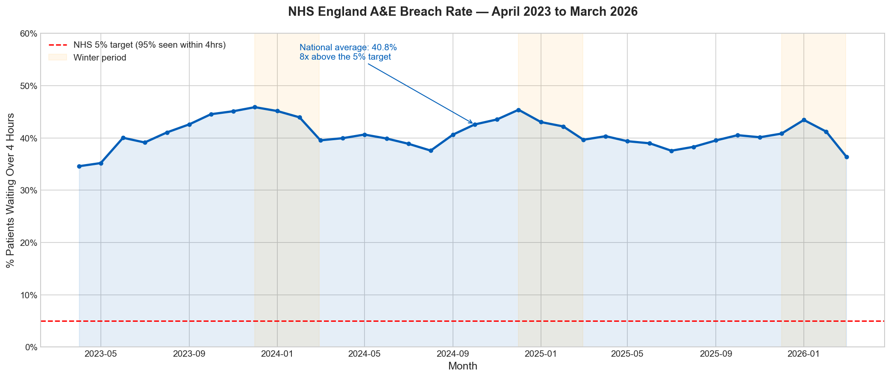
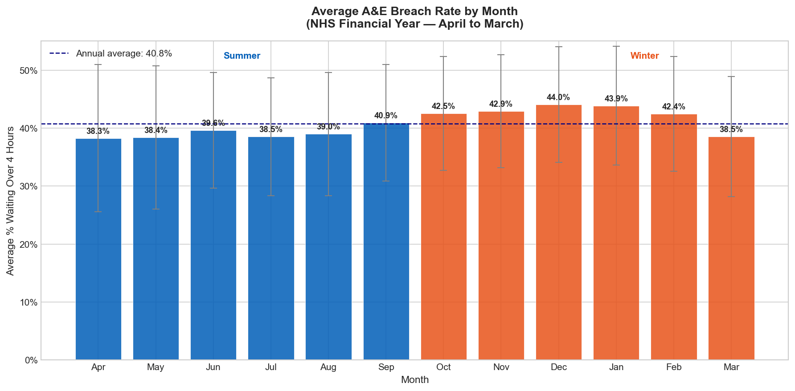
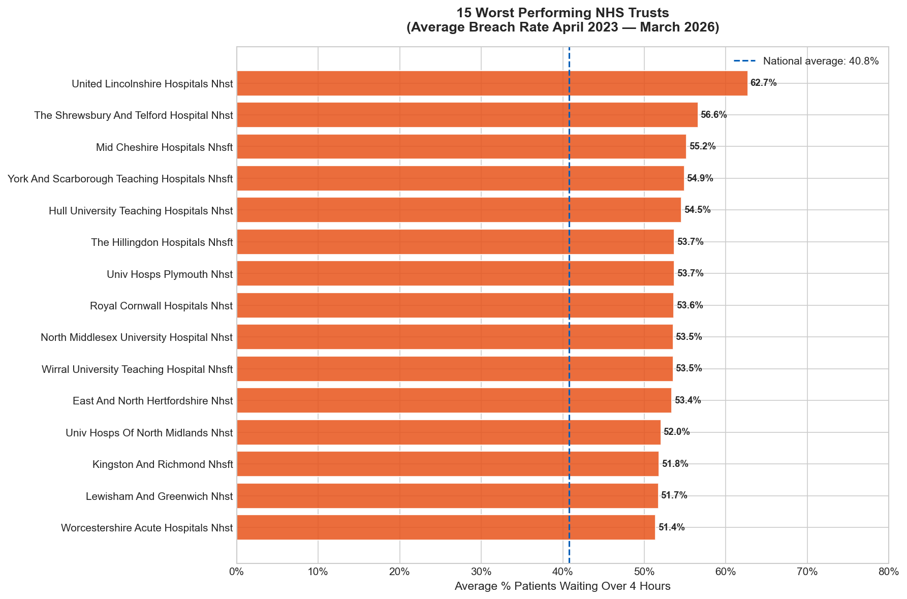
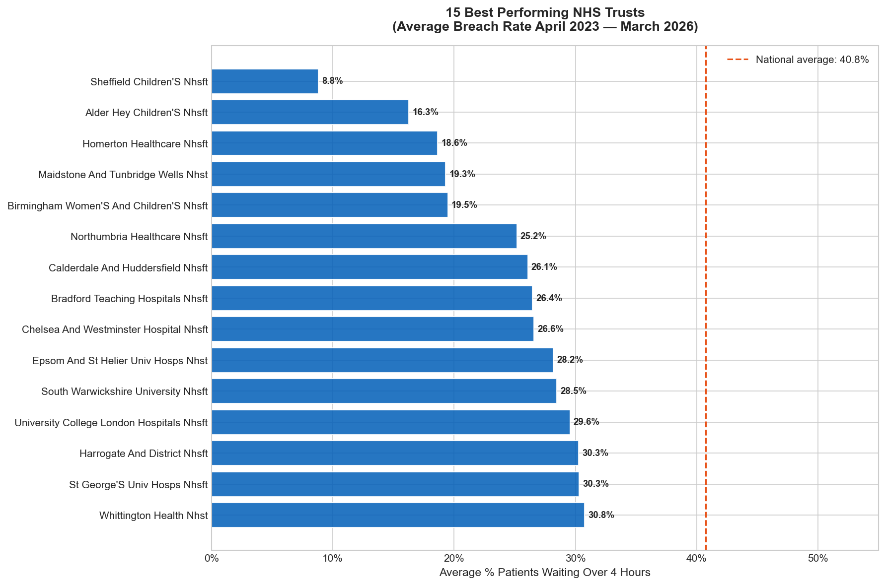
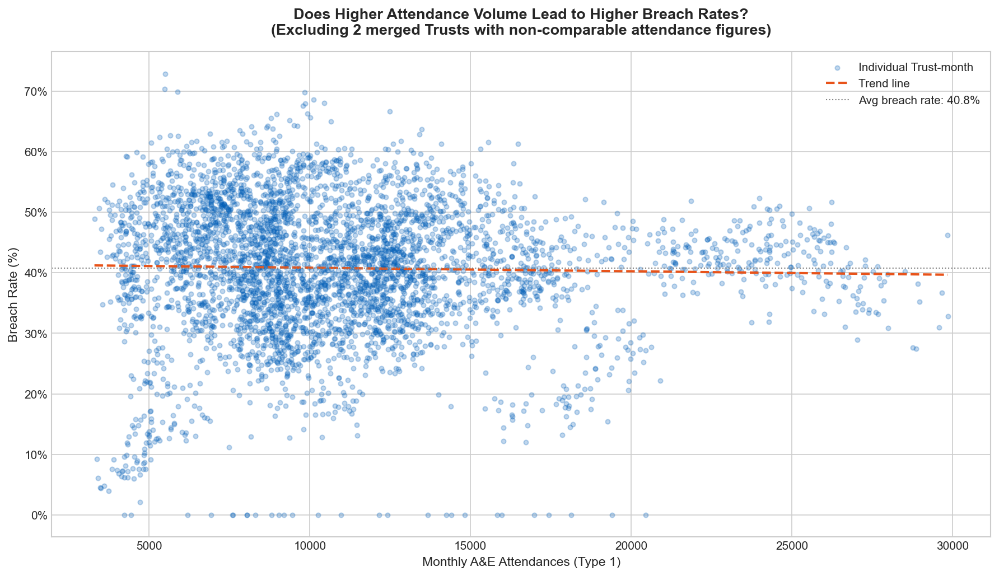
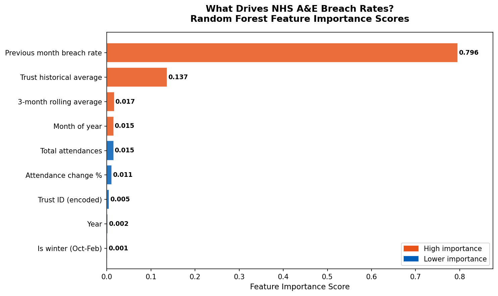
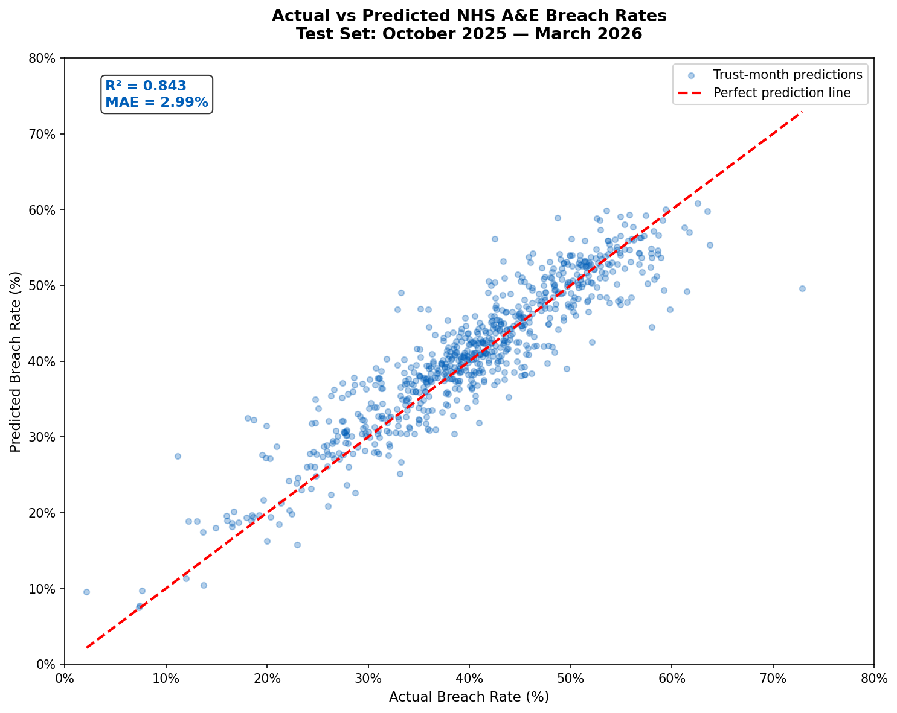

# NHS A&E Waiting Times: Predicting Pressure Points

Three years of NHS England data on major emergency departments (Type 1), used to find which Trusts and months are under the most pressure and to predict next month's breach rate for each Trust.

The full write up is in [docs/project-report.md](docs/project-report.md).

## The question

The NHS target is that 95% of A&E patients are seen, treated and either admitted or discharged within four hours. The share who wait longer is the breach rate, so the target is a breach rate of 5% or less. I used monthly Trust level data from April 2023 to March 2026 to ask three things:

1. Which Trusts are under the most pressure?
2. Is there a predictable seasonal pattern?
3. Can a model predict a Trust's breach rate for the next month?

## What I found

| Finding | Result |
|---|---|
| Average breach rate, Type 1 departments | 40.8% across 131 Trusts and 36 months |
| Worst single month | December 2023, 45.9% |
| Best single month | April 2023, 34.6% |
| Winter against summer | 43.2% in October to February, 38.8% in April to August, a gap of 4.4 points |
| Worst Trust | United Lincolnshire Hospitals, 62.7% (only 19 months of data in the file) |
| Best Trust | Sheffield Children's, 8.8%. Best general acute Trusts are Homerton Healthcare (18.6%) and Maidstone and Tunbridge Wells (19.3%) |
| Gap between best and worst Trust | 53.9 percentage points |
| Attendance volume against breach rate | Correlation of -0.026, so no meaningful relationship |

No month in the period came close to the 5% target.

## The model

A Random Forest Regressor, trained on April 2023 to September 2025 and tested on the six months after that (October 2025 to March 2026), which the model never saw.

| Metric | Random Forest | Baseline: same as last month |
|---|---|---|
| R² | 0.843 | 0.820 |
| Mean absolute error | 2.99 points | 3.17 points |
| Predictions within 5 points | 81.9% | not measured |
| Predictions within 10 points | 97.8% | not measured |

The previous month's breach rate carries 80% of the model's feature importance (0.796). A Trust's historical average comes second at 0.137. The honest reading is that a Trust's performance is persistent, and that the model improves only modestly on simply repeating last month's figure. The report explains what that means for using it.

## Charts









## Scope note

Every figure here covers Type 1 (major emergency) departments only. NHS headline figures usually combine all department types, and Type 3 urgent treatment centres pull that combined breach rate down, so the two sets of numbers are not comparable.

## Project structure

```
nhs-ae-waiting-times/
├── data/
│   ├── raw/          36 monthly CSV files from NHS England
│   └── processed/    cleaned and feature engineered datasets
├── notebooks/
│   ├── 01_data_loading.ipynb
│   ├── 02_exploratory_data_analysis.ipynb
│   ├── 03_feature_engineering.ipynb
│   └── 04_modelling.ipynb
├── outputs/charts/   7 charts
├── docs/
│   └── project-report.md
└── README.md
```

## Tools

Python, pandas, NumPy, scikit-learn, matplotlib, seaborn and Jupyter Notebook.

## Data source

NHS England, A&E Attendances and Emergency Admissions, published under the Open Government Licence v3.0:
https://www.england.nhs.uk/statistics/statistical-work-areas/ae-waiting-times-and-activity/

All data is aggregated at Trust level. No patient level data was used.

## How to run

1. Clone the repository.
2. Install the packages: `pip install pandas numpy matplotlib seaborn scikit-learn openpyxl xlrd`
3. Keep the NHS files in `data/raw/`.
4. Run the notebooks in order, 01 to 04.
