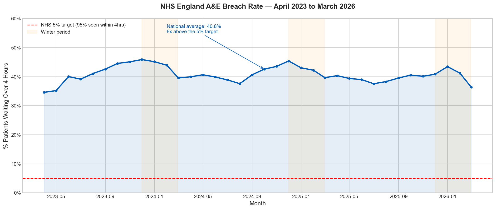
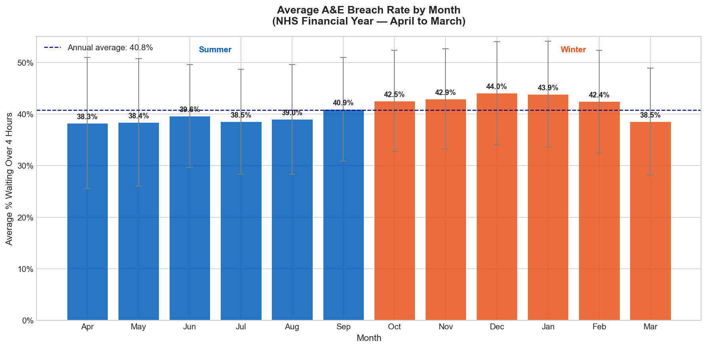
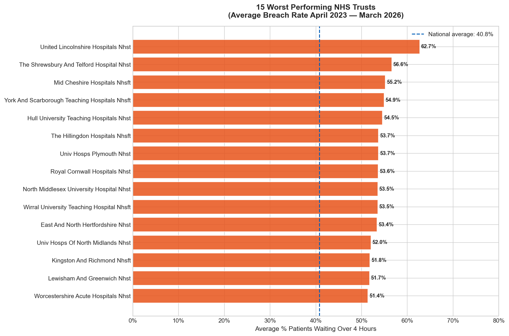
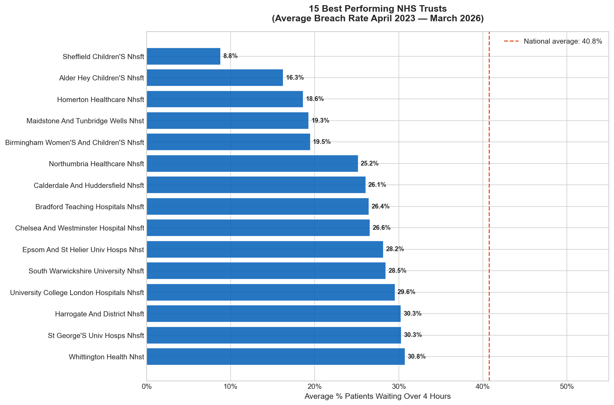
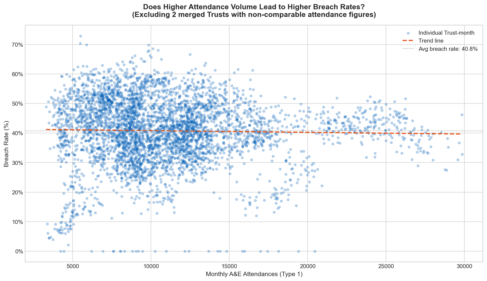
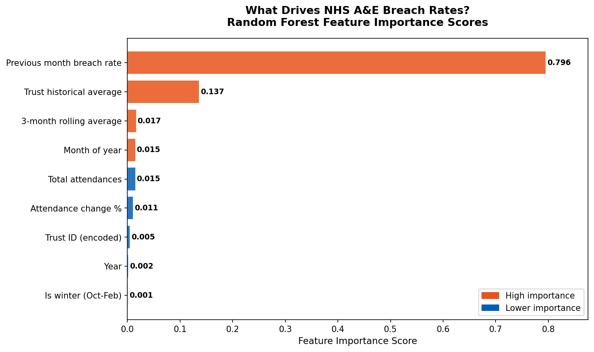
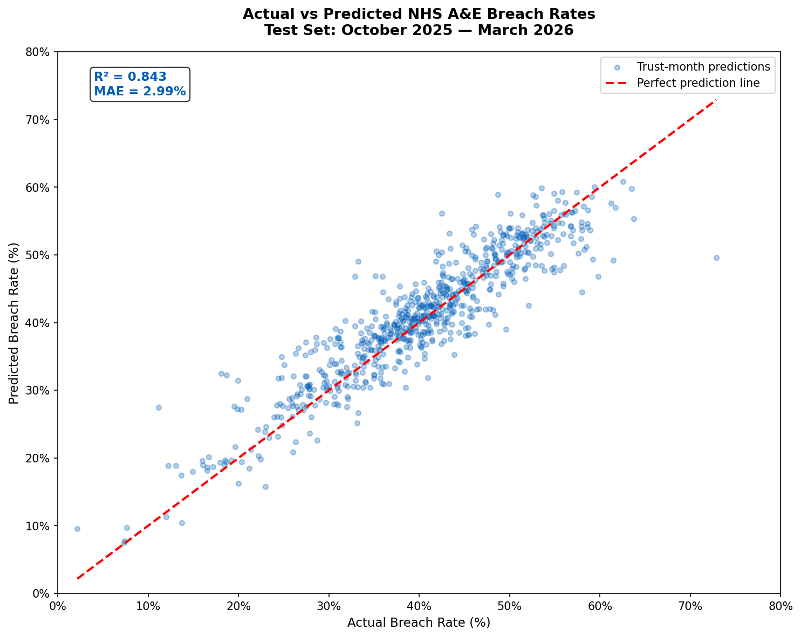

# NHS A&E Waiting Times: Predicting Pressure Points Across England

An MSc Business Analytics portfolio project by Obaloluwa Adelore. It uses three years of open NHS England data on major emergency departments to find where pressure is highest and to predict next month's breach rate for each Trust.

## 1. Background

NHS England sets a target that 95% of patients attending A&E are seen, treated and either admitted or discharged within four hours. The share who wait longer is the breach rate, so the target is a breach rate of 5% or less.

I wanted to know which hospitals struggle most, whether the pattern follows the seasons, and whether a model could predict a Trust's breach rate a month ahead. The project answers three questions:

1. Which Trusts are under the most pressure?
2. Is there a predictable seasonal pattern in A&E performance?
3. Can a machine learning model predict next month's breach rate accurately?

### Scope: Type 1 departments only

NHS England reports three types of A&E department. Type 1 departments are consultant led, open 24 hours and equipped for major emergencies. Type 2 departments are single specialty services such as eye or dental casualty. Type 3 covers urgent treatment centres, minor injury units and walk in centres.

Every figure in this project covers Type 1 only. I chose that for comparability: all the Trusts in the data run the same kind of service, so comparing them is fair. It also means my figures sit well above the all department headline rates that appear in the news. Type 3 centres see a large share of attendances and treat most patients quickly, which lowers the combined breach rate. The two sets of numbers measure different things and should not be compared with each other. I have not reproduced the official headline figures here, so check NHS England directly if you need them.

## 2. Data

The data comes from NHS England's A&E Attendances and Emergency Admissions statistics, published under the Open Government Licence v3.0. It is reported by each Trust every month.

| Item | Detail |
|---|---|
| Source | NHS England, Statistical Work Areas |
| Coverage | April 2023 to March 2026, 36 monthly files |
| Level | One row per Trust per month |
| Raw size | 7,217 rows across the 36 files |
| Clean size | 4,380 rows, 131 Trusts, 36 months |
| Variables used | Type 1 attendances, Type 1 attendances over four hours, Trust name and code, reporting month |

The notebooks print 132 Trusts at the loading stage. That count included a TOTAL summary row that NHS England adds to each file. Once it is removed, the data holds 131 Trusts.

## 3. Method

The work follows one notebook per stage.

### 3.1 Loading

I downloaded the 36 monthly CSV files and combined them in pandas with `glob`. Each row keeps a `source_file` column so any data quality problem can be traced back to the file it came from.

### 3.2 Cleaning

The raw files had several problems.

| Problem | Fix |
|---|---|
| Summary TOTAL rows at the bottom of each file | Removed, since they are not Trust data |
| Period values written as codes such as MSitAE-APRIL-2025 | Converted to proper dates |
| Unnamed columns left over from the Excel formatting | Dropped |
| Attendance values stored as text | Converted with `pd.to_numeric(errors='coerce')` |
| Rows with zero or missing attendances | Removed, because a breach rate cannot be calculated |
| One TOTAL row missed in the first pass | Found in notebook 03 and the clean file was rewritten |

The target variable is the breach rate for each Trust and month:

```python
combined['breach_rate'] = (
    combined['Attendances over 4hrs Type 1'] /
    combined['A&E attendances Type 1']
) * 100
```

I then removed values below 0 or above 100. The final clean file has 4,380 rows.

### 3.3 Feature engineering

I added six variables to give the model more to work with than the raw columns.

| Feature | How it is built |
|---|---|
| Previous month breach rate | Trust level lag of one month |
| Three month rolling average | Rolling window of three, shifted by one month so it never includes the current month |
| Winter flag | 1 for October to February, otherwise 0 |
| Trust historical average | Mean breach rate for each Trust |
| Attendance change | Month on month percentage change per Trust |
| Encoded Trust ID | `LabelEncoder` on the Trust name |

The data has to be sorted by Trust and date before the lag features are built. Without that, the "previous month" for a Trust's first row would belong to a different Trust. Building the lags dropped 261 rows that had no earlier month, which left 4,119 rows for modelling.

### 3.4 Train and test split

I split by time, not at random. The model trained on April 2023 to September 2025 (3,397 rows, 28 months) and was tested on October 2025 to March 2026 (722 rows, 6 months). A random split would let the model train on later months and be tested on earlier ones, which flatters the score. Splitting by time matches real use: learn from the past, predict what comes next.

### 3.5 Model

I used a Random Forest Regressor because it copes with non linear patterns and is stable on small tabular data.

```python
model = RandomForestRegressor(
    n_estimators=200,
    max_depth=15,
    min_samples_leaf=5,
    random_state=42,
    n_jobs=-1,
)
```

The model uses nine inputs: month, year, previous month breach rate, three month rolling average, winter flag, Trust historical average, attendance change, encoded Trust ID and Type 1 attendances.

## 4. What the data shows

### 4.1 The target was missed every month



The average breach rate across Trusts was 40.8%, so about four in ten patients waited longer than four hours. The lowest month was April 2023 at 34.6% and the highest was December 2023 at 45.9%. The gap to the 5% target ranged from about 30 points in the best month to about 41 in the worst. No month in the 36 came close.

A note on the 40.8% figure: it is the plain average of Trust level monthly rates, which counts every Trust equally. Weighting by attendances gives 40.6%, so the choice makes little difference.

### 4.2 Winter is worse, every year



Averaged across the three years, October to February runs at 43.2% and April to August at 38.8%, a gap of 4.4 points. December is the worst calendar month at 44.0% on average, with January close behind at 43.9%. The worst single month, December 2023 at 45.9%, is a different number from the December average, so the two should not be mixed up.

### 4.3 Poor performance is concentrated



The fifteen worst Trusts all average above 51%, more than ten points above the national figure. United Lincolnshire Hospitals is the worst at 62.7%. That Trust has only 19 months of data in the cleaned file and I did not investigate why, so its average rests on fewer months than the others. Several of the weakest Trusts serve rural or coastal areas. The data cannot say why, so I treat that as a lead to investigate and not a conclusion.

### 4.4 The best and the worst are far apart



Sheffield Children's is the best Trust at 8.8%, and Alder Hey Children's is next at 16.3%. Children's hospitals treat a different mix of patients, so comparing them with general hospitals needs care. Among general acute Trusts, Homerton Healthcare is best at 18.6%, followed by Maidstone and Tunbridge Wells at 19.3%. The gap between the best and worst Trust is 53.9 points, so good performance is achievable. The data does not show what the best Trusts do differently.

### 4.5 Being busy does not explain the breach rate



The correlation between monthly attendances and breach rate is -0.026 across 4,325 Trust months. A Trust seeing 5,000 patients a month has about the same breach rate as one seeing 25,000. Volume alone does not explain the problem. Things the data does not contain, such as staffing, bed availability and discharge delays, are the more likely drivers. I left out University Hospitals Birmingham and Mid and South Essex because their merged attendance figures sit far outside the range of the rest.

## 5. Model results

### 5.1 Test set performance

| Metric | Result |
|---|---|
| R² | 0.843 |
| Mean absolute error | 2.99 points |
| Root mean square error | 4.05 points |
| Predictions within 5 points | 81.9% |
| Predictions within 10 points | 97.8% |
| Mean error (bias) | -0.65 points |
| Worst single error | 23.3 points |

I set two targets before modelling, an R² above 0.70 and a mean absolute error below 6 points. The model met both. I re-ran the model from the saved features file with the same settings and got identical results.

### 5.2 Compared with a simple baseline

A model score only means something next to a simple alternative. Predicting that each Trust repeats last month's breach rate gives an R² of 0.820 and a mean absolute error of 3.17 points on the same test months. The Random Forest improves on that to 0.843 and 2.99 points.

That is a real but modest gain, about 0.2 points of error. Most of the predictive power comes from the fact that a Trust's performance changes slowly from one month to the next. I think this is the most important thing to know about the model.

### 5.3 What drives the predictions



| Feature | Importance |
|---|---|
| Previous month breach rate | 0.796 |
| Trust historical average | 0.137 |
| Three month rolling average | 0.017 |
| Month | 0.015 |
| Type 1 attendances | 0.015 |
| Attendance change | 0.011 |
| Encoded Trust ID | 0.005 |
| Year | 0.002 |
| Winter flag | 0.001 |

Previous month performance carries almost 80% of the importance. A Trust that struggles this month is very likely to struggle next month. The winter flag scores 0.001 because the month feature already carries the seasonal signal, and attendance volume scores 0.015, which agrees with the weak correlation in section 4.5.

### 5.4 Actual against predicted



Across the 722 test observations, predictions track the actual values from the lowest breach rates, under 10%, to the highest, over 70%. About 82% fall within 5 points and 98% within 10. The largest miss, 23.3 points, probably reflects a Trust whose performance changed suddenly. I have not checked which Trust or why.

## 6. Recommendations

These follow from the analysis. I have tried to keep each one within what the data supports.

1. **Plan winter capacity earlier.** The seasonal rise is consistent across all three years, and breach rates are already climbing in October. Staffing and bed planning that waits for November starts after the pressure has begun.
2. **Focus improvement support on the persistently weak Trusts.** Poor performance is spread unevenly and persists month after month, so a targeted programme is likely to do more than equal support for every Trust.
3. **Use the model as a screening aid, not a replacement for judgement.** It flags Trusts likely to stay above or move away from their recent level, one month ahead. Because it beats a last month baseline by only a small margin, a team that already tracks last month's figures gains little from it alone. Its value would grow if it were extended with the missing drivers below.

## 7. Limitations

| Limitation | What it means |
|---|---|
| Type 1 only | Findings do not cover the whole A&E system, and the numbers are not comparable with all department headline figures. |
| Equal weighting of Trusts | The 40.8% average treats each Trust equally. The attendance weighted figure is 40.6%. |
| Strong dependence on last month | The model leans on the previous month's rate and may be slow to react to sudden change such as strikes, a major incident or new leadership. |
| Historical average uses all months | The Trust historical average is calculated over the full 36 months, so it includes the test period. This is a mild form of leakage that may make the score slightly optimistic. A stricter version would calculate it from the training months only. |
| Missing explanatory variables | Staffing, bed availability, discharge delays and patient acuity are not in the data, so the model can predict but cannot explain. |
| Children's hospitals | They have a different patient mix and are not directly comparable with general acute Trusts. |
| Uneven Trust history | Some Trusts have fewer than 36 months of data, and United Lincolnshire has 19. |
| One test window | The model was tested on six months only. A longer or rolling test would give a firmer estimate. |

## 8. Tools

Python, pandas, NumPy, scikit-learn, matplotlib, seaborn and Jupyter Notebook, with Git and GitHub for version control.

## 9. Data licence

All data is published by NHS England under the Open Government Licence v3.0, which allows free use, analysis and publication provided the source is credited. No patient level data was used. NHS England aggregates everything to organisation level before publication.

Source: https://www.england.nhs.uk/statistics/statistical-work-areas/ae-waiting-times-and-activity/
